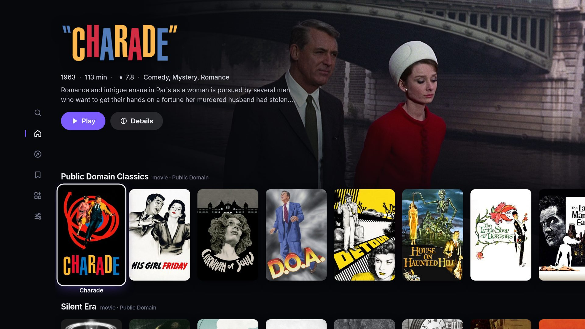
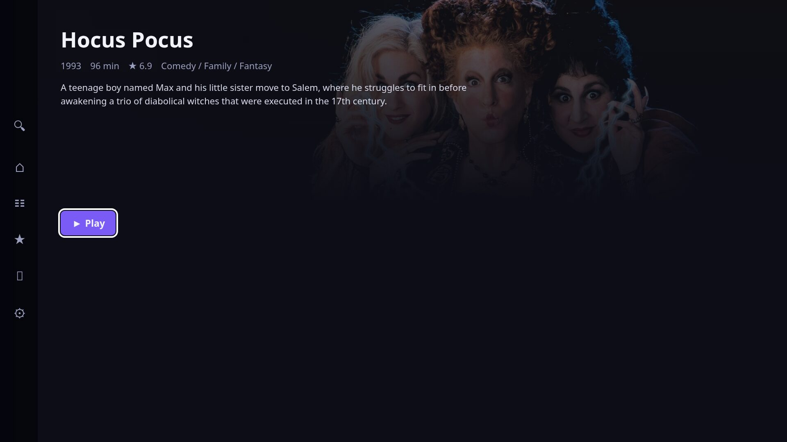
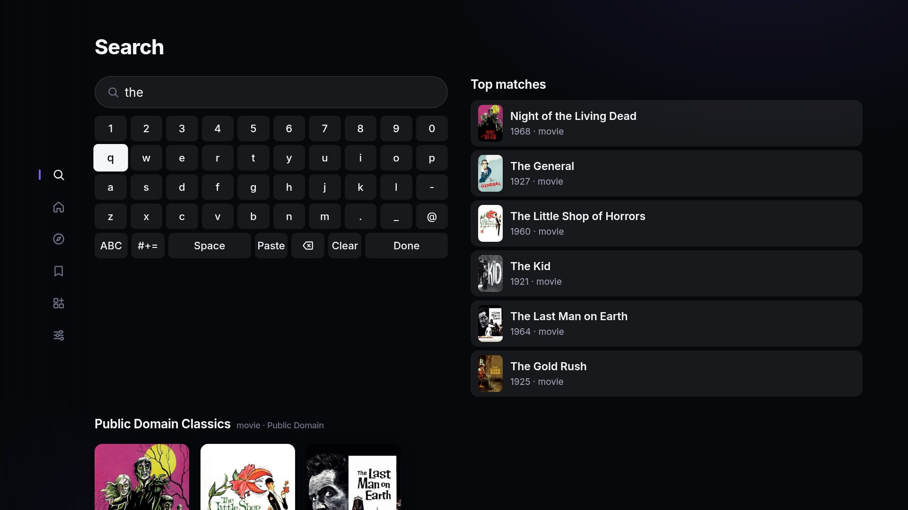
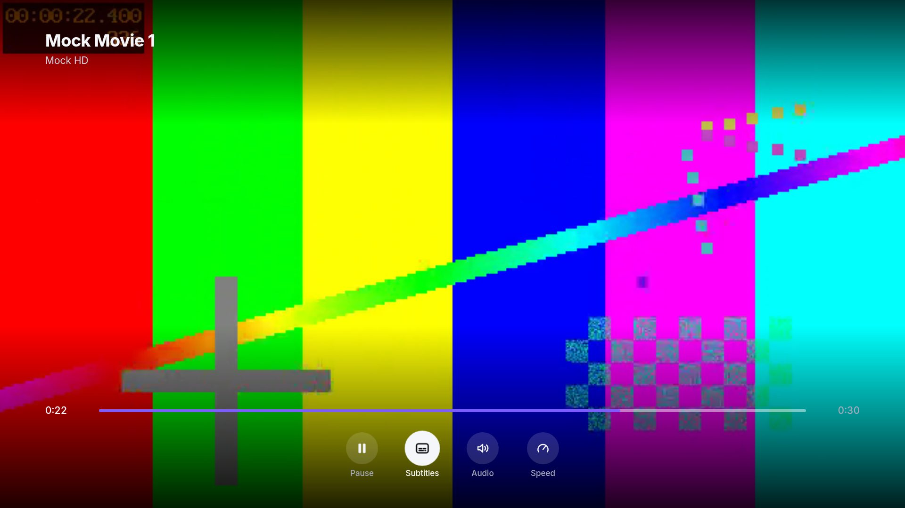

# Stremio TV

A **TV-first Stremio client** built for [KDE Plasma Bigscreen](https://invent.kde.org/plasma/plasma-bigscreen)
and other remote-controlled Linux boxes.

Stremio's official desktop apps (stremio-web / stremio-linux-shell) are designed for a
mouse. This app speaks the same **Stremio addon protocol** — so all your addons,
including **AIOStreams**, work exactly the same — but the whole interface is built for a
remote: arrow keys, OK, and Back are all you need.



| | |
| --- | --- |
|  |  |
| **Title page** — Play / Resume, seasons and episodes | **Search** — results while you type; → jumps into the matches |
|  | |
| **Player** — libmpv video under the remote-friendly controls (test pattern) | |

<sub>Screenshots show public-domain films, with metadata and artwork from Cinemeta.</sub>

## Features

- **Always fullscreen** — a kiosk-style window; if the compositor drops fullscreen it re-enters it.
- **100% arrow-key navigable** — a spatial-navigation engine drives every screen; nothing needs a pointer.
- **Nav rail** — press **Left** from anywhere to reach Search / Home / Discover / Library / Add-ons / Settings.
- **Full addon support** — install any addon by manifest URL (AIOStreams, Torrentio, Cinemeta, …) or
  **import your addon collection from your Stremio account**.
- **YouTube-TV-style player**:
  - **OK** → play/pause
  - **Left/Right** → seek −10s/+10s; repeated presses accelerate to 30s/60s/120s steps
  - **Up/Down** → show the control row (Pause · Subtitles · Audio · Speed · Next episode)
  - **Back** → hide controls / stop playback (progress is saved)
- **Continue Watching** — progress is stored locally; resume from Home, Library, or the title page.
- **Subtitles** — embedded tracks plus subtitle addons (e.g. OpenSubtitles), with adjustable size.
- **Search built for the remote** — the on-screen keyboard sits next to a **Top matches** list
  that updates as you type: press **Right** to move into it and **OK** to open a title, no need
  to press Done. Full result rows sit below. With an empty query you get your **recent
  searches** (OK runs one again). Press any letter on any screen (physical/HDMI-CEC keyboard)
  to land in Search with it typed; **Backspace deletes**, and you can **paste** with Ctrl+V or
  the keyboard's Paste key — handy for long AIOStreams URLs.
- **Series support** — season picker, episode list, auto "next episode" (binge groups auto-pick the same source).

## Install

Stremio TV is a native Qt 6 app with embedded **libmpv** playback. Download the Flatpak
for your box from the [Releases page](https://github.com/shreyasajj/stremio-tv/releases)
(`x86_64` for most mini PCs, `aarch64` for ARM boards), then:

```bash
flatpak remote-add --user --if-not-exists flathub https://dl.flathub.org/repo/flathub.flatpakrepo
flatpak install --user ./stremio-tv-x86_64.flatpak
flatpak run io.github.shreyasajj.StremioTV
```

It shows up in the app launcher as **Stremio TV** (a tile in Plasma Bigscreen). Runs on
Linux with Plasma Bigscreen or any Wayland/X11 desktop; the app is always fullscreen.
To build from source, see [native/README.md](native/README.md).

## First start & AIOStreams

1. On first start the app installs the default **Cinemeta** (catalogs/metadata) and
   **OpenSubtitles** addons.
2. Open **Add-ons** in the left nav rail → **Add addon by URL** → enter your AIOStreams manifest
   URL (the `https://…/manifest.json` link from your AIOStreams configuration page —
   `stremio://` links work too).
   Or use **Import from Stremio account** to pull everything you already have configured.
3. Pick anything from Home/Discover/Search → **Play** → choose an AIOStreams result.

Debrid/direct HTTP streams play natively. **Raw torrent streams** (`infoHash` results,
e.g. Torrentio without debrid) need Stremio's streaming server: run it somewhere
(`stremio-service` provides it on port 11470) and set its URL in **Settings → Streaming
server URL** (e.g. `http://127.0.0.1:11470`).

## Remote / key mapping

| Key                                   | Action                                    |
| ------------------------------------- | ----------------------------------------- |
| Arrow keys                            | Move focus / seek (in player)             |
| Enter / OK / Select                   | Activate / play-pause                     |
| Esc / Backspace / Back                | Go back / hide player controls / exit app |
| Play-Pause / Stop / FF / RW media keys| Player control from anywhere              |

Most TV remotes (HDMI-CEC via `cec-ctl`, Bluetooth remotes, air mice) present these as
regular keyboard keys, which is all the app listens for.

## Focus & power behavior

- **Losing focus pauses playback.** If you switch to another app (or the window is
  hidden), the video pauses immediately — no decoding, no stream downloading, no audio
  behind whatever is now on screen. It stays paused when you come back; press **OK** to
  resume from the paused overlay.
- **The screen stays awake only while playing.** A power-save blocker is held during
  playback and released the moment you pause or stop, so the box can blank/sleep normally
  otherwise.

## Do I need the Stremio streaming server (backend)?

**Usually no.** In official Stremio, the UI and playback are separate pieces (the
streaming-server backend downloads/serves the stream, and on desktop an external player
process plays it) — which is why a crashed frontend there can leave audio playing.
Stremio TV has no such split: the video plays inside the app's own window, in the same
process tree. If the app closes or crashes, playback dies with it, and losing focus
pauses it (see above). There is no separate service to install, start, or leak resources.

The one thing the backend provides that this app doesn't is a **torrent engine**. Streams
that are direct HTTP links — everything AIOStreams/debrid returns — play natively. Only
if you want addons that return raw torrent `infoHash` results (e.g. Torrentio without
debrid) do you need Stremio's streaming server running somewhere, with its URL set in
**Settings → Streaming server URL**.

## Codec notes

Playback goes through libmpv/FFmpeg: H.264, HEVC, AV1, VP9 and the rest, in MKV, MP4,
HLS or DASH, with VAAPI hardware decoding where the box supports it. Audio track
switching works in single-file MKVs, and **Settings → Surround passthrough** can send
Dolby/DTS untouched to a TV or soundbar.

## Development & tests

The UI is plain HTML/CSS/JS in `ui/`; the native shell (`native/`) hosts it in a Qt
WebEngine view over libmpv. A source build loads `ui/` directly, so UI edits only need an
app restart (see [native/README.md](native/README.md)).

```bash
npm ci                    # test tooling (playwright-core)
npm run serve             # serve the UI at http://127.0.0.1:8099/ui/index.html
npm run mock-addon        # local offline test addon on http://127.0.0.1:7010
npm run test:addons       # live addon-protocol smoke test against Cinemeta (needs internet)
npm run test:ui           # headless Chromium drives the UI with arrow keys (SHOTS=1 for screenshots)
npm run test:native-flow  # player flow against a simulated native shell
```

The UI tests need a Chromium binary (`CHROMIUM_PATH`). The end-to-end test of the real
app (Qt, libmpv, Wayland, PulseAudio) runs in Docker:

```bash
docker build -t stremio-tv-native-dev native/dev
docker run --rm -v "$PWD":/src -w /src -e SHOTS=1 stremio-tv-native-dev sh native/dev/run-tests.sh
```

Project layout: `native/` is the Qt shell; `ui/` holds `js/nav.js` (spatial navigation),
`js/addons.js` (addon protocol client), `js/player.js` (player + overlay),
`js/mpv-video.js` (libmpv as a `<video>`-like element), `js/screens/*` (screens) and
`js/stremio-api.js` (account login/addon import).
