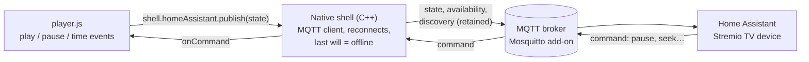

# Stremio TV × Home Assistant: brainstorm

_Draft, 2026-11-03. The MQTT design (approach A, both setup paths) is now built; see the README's "Home Assistant" section._

## TL;DR

Start with **MQTT + MQTT Discovery**: no Home Assistant code to write, and a "Stremio TV"
device with its entities appears in HA on its own. Add a custom integration later only if
you want the full media-player card.

- **What HA gets:** playing / paused / idle, the title (and S01E02 for series), position,
  duration, % watched, the poster, plus Play/Pause buttons you can press from HA.
- **What you need:** an MQTT broker. Most HA setups already have one (the Mosquitto
  add-on, often installed for Zigbee2MQTT).
- **The catch:** HA's MQTT support has no media-player entity type, so you get sensors
  and buttons rather than the media card with a scrubber. That is the main reason to
  build an integration later.
- **"SSO":** Mosquitto takes a username and password, not an HA login. Enter them either
  by scanning a QR code on the TV and filling in a form on your phone, or by typing them
  on the TV with the on-screen keyboard.

## What Home Assistant should know

Everything below is already known to the player while it plays; nothing new has to be
looked up.

| Field | Example | Notes |
| --- | --- | --- |
| State | `playing` / `paused` / `idle` | `idle` = player closed; `offline` = app not running |
| Title | Night of the Living Dead | the movie or series name |
| Episode | S01E02 — Cat's in the Bag... | series only |
| Type | movie / series | |
| Position | 1:12:30 (4350 s) | send seconds; HA can format them |
| Duration | 1:36:00 (5760 s) | |
| Progress | 75 % | handy for automations ("almost done") |
| Poster | image URL | for a dashboard picture card |
| IMDb id | tt0063350 | lets HA link out or look things up |

**Control back (optional):** play/pause, stop, and seek ±30 s from HA, e.g. pause the
movie when the doorbell rings.

## Integration, MQTT, or the REST API?

MQTT with Discovery is the best first step: least work, survives HA restarts, and gives
control back. A custom integration is the upgrade path to a true media player.

| Option | Work | What shows up in HA | Control from HA | Survives HA restart | Notes |
| --- | --- | --- | --- | --- | --- |
| **MQTT + Discovery** (recommended start) | App only | A device with sensors (state, title, position, progress) and buttons | Yes, via command topic | Yes (retained messages) | Needs a broker; no media-player card |
| **Custom integration** (HACS) | App + Python integration | A real `media_player` entity: media card, poster, scrubber, play/pause | Yes | Yes | Most polished; needs maintaining and an HACS install |
| **Integration that reads the MQTT topics** | App (MQTT) + small integration | Same media player as above | Yes | Yes | Best of both: the app stays MQTT-only, the integration only maps topics to a media player |
| **HA REST API** (`POST /api/states/…`) | App only | One sensor with attributes | No | No: the entity disappears until the next update | Needs a long-lived token; fine for a quick test |
| **Webhook trigger** | App + an automation | Nothing by itself; automations react to events | No | n/a | Simplest possible, but no state to look at |

An existing HACS integration for generic MQTT media players may already cover the third
row; worth a look before building one.

## Signing in: QR code + Mosquitto

Mosquitto doesn't understand Home Assistant logins. It wants a username and password,
while HA's login (the QR/OAuth flow) hands the app an **HA access token**. So "log in to
HA with a QR code" and "talk to Mosquitto" don't connect directly. Pick one of these:

| Approach | What the QR code does | The app talks to | Works with your Mosquitto | Trade-offs |
| --- | --- | --- | --- | --- |
| **A. Phone-assisted broker setup** (recommended) | Opens a setup page served by the TV box; you type the broker login on your phone | Mosquitto directly | Yes, add-on or standalone | No HA login at all. Keeps the "last will", so HA sees `offline` the instant the app dies |
| **B. HA login, MQTT relayed by HA** | Signs you in to HA; the app gets an HA token | HA's WebSocket API, which relays to Mosquitto (`mqtt.publish` to send, `mqtt/subscribe` for commands) | Yes, through HA's MQTT integration | No broker password needed. But no last will (use a heartbeat + `expire_after` instead), receiving commands likely needs an HA admin user, and nothing works while HA restarts |
| **C. HA login, then read the broker login from HA** | n/a | n/a | No | HA's API does not hand out the MQTT integration's stored password |

### Two ways to enter the broker login

Settings → Home Assistant offers both; they fill in the same four fields (broker address,
port, username, password) and end in the same connection test.

| | On the TV | On the phone | Best when |
| --- | --- | --- | --- |
| **Scan a QR code** | Shows the QR code, then *Connected* or the error | Fill in the form with the phone keyboard | Long passwords, no keyboard on the TV |
| **Enter manually** | Each field with the on-screen keyboard (Paste key works) | n/a | No phone handy, or a keyboard/CEC keyboard is plugged in |

Either way, every field can be changed later on its own from the same Settings screen.

### The QR code, step by step

1. **On the TV:** Settings → Home Assistant → *Set up with phone*. The TV shows a QR code and
   the same link in text, e.g. `http://192.168.1.50:8765/setup?code=4F7K`.
2. **On the phone:** scan it. A small form opens with the broker address, port (`1883`),
   username and password. The address can be pre-filled with HA's address, found over mDNS
   (`_home-assistant._tcp`), since the Mosquitto add-on runs on the HA host.
3. **Submit:** the TV tries to connect and shows *Connected* or the broker's error, on the TV
   and on the phone page. On success the setup page shuts down.
4. **Safety:** the page only exists while the setup screen is open, needs the one-time code
   from the QR, stops after 5 minutes or one success, and is reachable on your LAN only.

**The broker user:** create a dedicated `stremio-tv` login so it can be revoked on its own.
With the Mosquitto add-on, that is a non-admin HA user (or a login in the add-on's
config); with a standalone Mosquitto, `mosquitto_passwd`.

### B, if a real "Sign in with Home Assistant" matters later

HA's login is OAuth2-style. The app runs the same tiny web page on the box; the QR code
points your phone at HA's login page with the box as the redirect. After you sign in, HA
sends the phone back to the box with a code, and the app trades it for a refreshable
token. The app then publishes through HA's `mqtt.publish` action and receives commands
over HA's WebSocket API.

## Proposed MQTT design

The app publishes one retained JSON state message plus an online/offline flag, and
listens on one command topic. Discovery messages turn these into HA entities
automatically.

| Topic | Direction | Retained | What |
| --- | --- | --- | --- |
| `stremio_tv/<box>/state` | app → HA | yes | the JSON below, on every change and every 15 s while playing |
| `stremio_tv/<box>/availability` | app → HA | yes | `online`; the broker sends `offline` itself if the app dies (MQTT "last will") |
| `stremio_tv/<box>/command` | HA → app | no | `play`, `pause`, `toggle`, `stop`, `seek:+30`, `seek:-30` |
| `homeassistant/device/stremio_tv_<box>/config` | app → HA | yes | discovery: declares the device and its entities once at start |

Example state message:

```json
{
  "state": "playing",
  "title": "Night of the Living Dead",
  "type": "movie",
  "episode": null,
  "position": 4350,
  "duration": 5760,
  "progress": 75.5,
  "poster": "https://images.metahub.space/poster/medium/tt0063350/img",
  "imdb_id": "tt0063350",
  "updated_at": "2026-11-03T20:41:05Z"
}
```

**Entities from discovery** (one "Stremio TV" device):

- `sensor.stremio_tv_state`: playing / paused / idle
- `sensor.stremio_tv_title`, with the episode, type and IMDb id as attributes
- `sensor.stremio_tv_position` and `sensor.stremio_tv_duration`, in seconds (shown as h:mm:ss)
- `sensor.stremio_tv_progress`, in %
- `image.stremio_tv_poster`, for a picture card
- `button.stremio_tv_play_pause`, `button.stremio_tv_stop`, `button.stremio_tv_skip_forward`

**Why every 15 s and not every second:** fewer writes to HA's history database.
`updated_at` lets a dashboard estimate the live position between messages.

## How it fits in the app

The player already has every field: `ui/js/player.js` knows the title, poster and
episode from the stream it opened, and gets play, pause, time and end events from mpv
(it already saves watch progress every 5 s). The MQTT connection itself is best kept in
the native shell, so it outlives the web page.



- **Why the native shell, not the web UI:** the connection and its "last will" belong to
  the process, so HA sees `offline` the moment the app quits or crashes, even if the web
  page is reloading. The web UI would need MQTT over WebSockets instead (Mosquitto's
  add-on also offers that), and loses the connection on every page reload.
- **Library:** libmosquitto (a small C library) in `native/`. The Flatpak already builds
  FFmpeg, libmpv and friends from source, so it is one more module in the same style; the
  dev container gets it from Debian's `libmosquitto-dev`. QtMqtt would also do, but it is
  unclear whether the KDE runtime ships it.
- **Bridge:** two new `window.shell` calls, `homeAssistant.publish(state)` and
  `homeAssistant.onCommand(fn)`, next to the existing mpv ones in `native/bridge.js`.
- **Settings screen:** a new "Home Assistant" item with
    - on/off and the connection status (*Connected* / the broker's error);
    - *Set up with phone*: the QR code flow above;
    - *Enter manually*: broker address, port, username and password, one on-screen
      keyboard prompt each, the same way the Stremio account login works today;
    - a box name, and *Test connection*.
- **Privacy:** off by default. When on, it sends what you watch to your own broker on
  your network; say so on the settings item.

## Example: using it in Home Assistant

Lights down when a movie starts after sunset, back up on pause:

```yaml
- alias: Movie time lights
  triggers:
    - trigger: state
      entity_id: sensor.stremio_tv_state
      to: playing
  conditions:
    - condition: sun
      after: sunset
  actions:
    - action: light.turn_on
      target:
        entity_id: light.living_room
      data:
        brightness_pct: 10

- alias: Lights up on pause
  triggers:
    - trigger: state
      entity_id: sensor.stremio_tv_state
      from: playing
      to: paused
  actions:
    - action: light.turn_on
      target:
        entity_id: light.living_room
      data:
        brightness_pct: 50
```

Pause the movie when the doorbell rings:

```yaml
- alias: Doorbell pauses the movie
  triggers:
    - trigger: state
      entity_id: binary_sensor.doorbell
      to: "on"
  conditions:
    - condition: state
      entity_id: sensor.stremio_tv_state
      state: playing
  actions:
    - action: mqtt.publish
      data:
        topic: stremio_tv/living_room/command
        payload: pause
```

A "Now playing" dashboard card:

```yaml
type: vertical-stack
cards:
  - type: picture-entity
    entity: image.stremio_tv_poster
    show_state: false
  - type: entities
    entities:
      - sensor.stremio_tv_title
      - sensor.stremio_tv_state
      - sensor.stremio_tv_progress
      - button.stremio_tv_play_pause
```

Position as "1:12:30" in a template:

```jinja
{{ states('sensor.stremio_tv_position') | int | timestamp_custom('%H:%M:%S', false) }}
```

## Decisions

| Question | Decision |
| --- | --- |
| Broker | Mosquitto (already running) |
| How many TVs | One. The box name defaults to `living_room` and can be changed later |
| First version in HA | Sensors + buttons; the media-player card comes later |
| Control from HA | Yes: play, pause, toggle, stop, seek ±30 s |
| What to send | Everything in the table above, titles and poster included |
| MQTT library | libmosquitto (see "How it fits in the app") |
| Setup | Either: QR code → phone form, or the broker address, username and password typed on the TV. Both connect to Mosquitto directly (approach A) |

Still open: is Mosquitto the HA add-on or a standalone install? It only changes how the
`stremio-tv` broker user is created.
